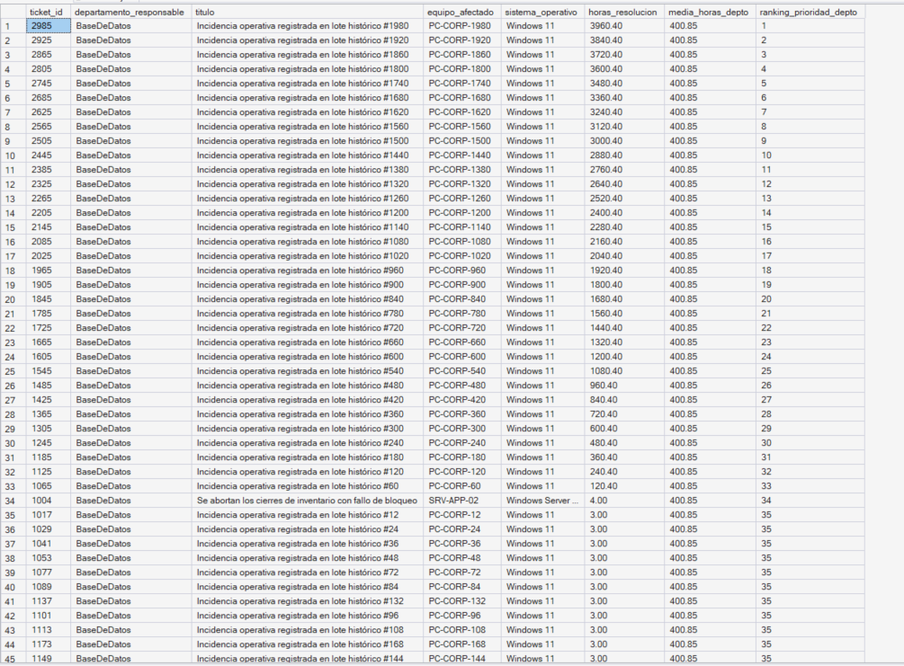
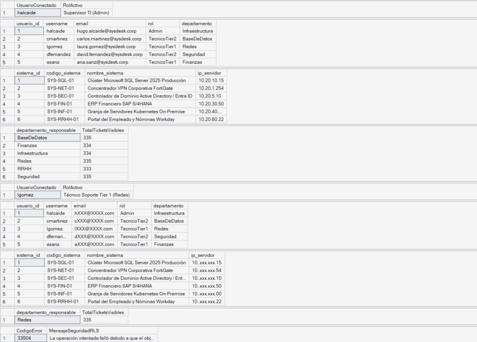
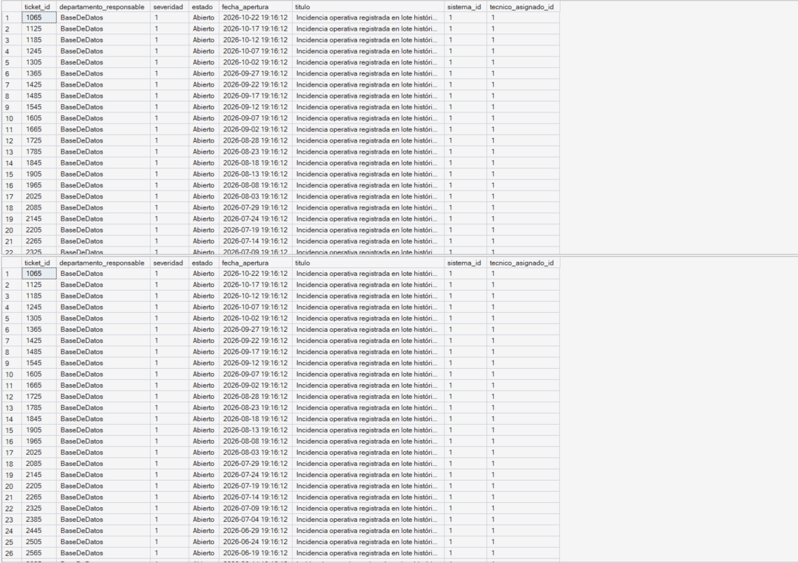
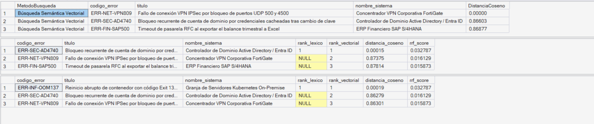
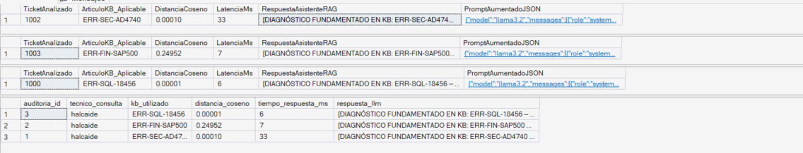
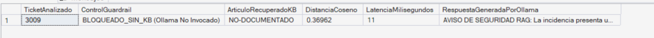

# SysDesk AI: Plataforma Inteligente de Soporte TI y Asistente RAG Nativo en SQL Server 2025

**Autor:** Hugo Alcaide Martínez  
**Certificación Objetivo:** Microsoft Certified: SQL Server Developer Associate (DP-800)  
**Nivel de Implementación:** Nivel 3 — Avanzado (Base de Datos Relacional + Seguridad + Optimización + Vector Search DiskANN + Hybrid RRF + RAG Dual con Guardrails y Ollama en Vivo)  
**Fecha:** Octubre 2026  

---

## 1. Portada y Resumen Ejecutivo

**SysDesk AI** es una solución integral de gestión de incidencias de TI (ITSM) y asistencia inteligente para ingenieros de soporte construida íntegramente sobre el motor **Microsoft SQL Server 2025 (nivel de compatibilidad 170)**. El proyecto demuestra cómo unificar en una única plataforma transaccional el diseño relacional normalizado, la seguridad corporativa a nivel de fila y columna, la optimización avanzada de consultas y los flujos modernos de Inteligencia Artificial Generativa (**Vector Search, Búsqueda Híbrida RRF y Retrieval-Augmented Generation con Guardrails Semánticos e inferencia local mediante Ollama Llama 3.2**).

---

## 2. Objetivo del Proyecto

El objetivo principal es diseñar, implementar y validar empíricamente una base de datos de soporte técnico empresarial que reduzca el tiempo medio de diagnóstico y resolución (MTTR) de incidencias críticas, cumpliendo el 100 % de los dominios técnicos de la certificación **DP-800**:
1. Garantizar la integridad de los datos operativos y el cálculo automatizado de acuerdos de nivel de servicio (SLA).
2. Proteger la infraestructura crítica y los datos personales mediante políticas nativas de seguridad (**Dynamic Data Masking** y **Row-Level Security**).
3. Optimizar las colas de atención en tiempo real reduciendo las lecturas lógicas de disco mediante índices compuestos, cubrientes y filtrados.
4. Dotar al motor SQL de capacidades de búsqueda semántica, híbrida y generación aumentada por recuperación (**RAG**) sin depender de bases de datos vectoriales externas, incorporando mecanismos de control de calidad (*Guardrails*) que impidan las alucinaciones del modelo de lenguaje.

---

## 3. Caso de Uso de Negocio

En un departamento de Sistemas dividido en áreas especializadas (*Base de Datos, Redes, Seguridad, Infraestructura, Finanzas y RRHH*), se presentan cuatro retos diarios:
* **Fricción semántica en las búsquedas:** Los usuarios finales reportan incidencias con lenguaje no técnico (*"se queda colgado al sacar las facturas"*), mientras que la Base de Conocimiento (KB) registra causas raíz técnicas (*"Timeout de pasarela RFC en SAP S/4HANA"*).
* **Riesgo de alucinaciones en asistentes de IA convencionales:** Consultar errores técnicos o corporativos en modelos de lenguaje genéricos sin contexto provoca respuestas inventadas o procedimientos no autorizados por la empresa.
* **Riesgo de exposición de datos sensibles:** Un técnico de nivel 1 de *Finanzas* no debe poder consultar ni modificar tickets del área de *Seguridad*, ni visualizar las direcciones IP reales de los servidores centrales ni enviar telemetría interna a nubes públicas.
* **Latencia en colas de guardia:** A medida que el histórico de tickets cerrados crece a miles de registros, las consultas que filtran únicamente los tickets activos urgentes sufren degradación por escaneos completos de tabla.

---

## 4. Arquitectura de la Solución

La arquitectura sigue un modelo **Database-Centric AI**, donde SQL Server 2025 actúa simultáneamente como almacén transaccional, guardián de seguridad y orquestador de IA:

1. **Capa de Acceso y Seguridad (`sec`):** Filtra de forma transparente las filas según el departamento del usuario conectado (`RLS`) y enmascara columnas sensibles (`DDM`).
2. **Capa Transaccional y Analítica (`dbo`):** Gestiona el ciclo de vida de los tickets, almacena telemetría semiestructurada en columnas nativas `JSON` y evalúa el cumplimiento de SLA.
3. **Capa de Búsqueda Inteligente e IA:** Almacena representaciones vectoriales en columnas `VECTOR(384)`, acelera la búsqueda aproximada mediante índices `DISKANN`, fusiona resultados léxicos y semánticos con **RRF**, evalúa umbrales de distancia coseno (*Semantic Guardrails*) y ensambla prompts aumentados tanto para síntesis determinista local como para inferencia en tiempo real contra **Ollama (`llama3.2`)** vía `sp_invoke_external_rest_endpoint`.

---

## 5. Modelo de Datos

El diseño se encuentra en **Tercera Forma Normal (3FN)** e integra cinco entidades:
* **`dbo.usuarios`:** Identidad, rol (`Admin`, `TecnicoTier1`, `TecnicoTier2`, `UsuarioFinal`) y departamento.
* **`dbo.sistemas`:** Catálogo de activos críticos con su dirección IP (`ip_servidor`), nivel de criticidad y horas objetivo de SLA.
* **`dbo.kb_articulos`:** Artículos técnicos de resolución con su código de error oficial y el vector semántico **`contenido_embedding VECTOR(384)`**.
* **`dbo.tickets`:** Registro de incidencias con control de severidad (`1` a `4`), estado, validación temporal (`fecha_resolucion >= fecha_apertura`) y telemetría en tipo nativo **`metadatos_diagnostico JSON`**.
* **`dbo.auditoria_rag`:** Trazabilidad de cada consulta realizada al asistente de IA, registrando la distancia coseno, el contexto JSON inyectado, la respuesta generada y el tiempo de respuesta en milisegundos.

---

## 6. Funcionalidades Implementadas (Bloques A – G)

* **Bloque A (Desarrollo de Base de Datos):** Vistas operativas (`vw_panel_operativo_sla`), funciones escalares (`fn_CalcularHorasResolucion`), triggers *set-based* (`trg_tickets_SellarResolucion`), procedimientos transaccionales (`usp_ResolverTicketConKB`) y consultas avanzadas con `CTE`, funciones de ventana (`DENSE_RANK`, `AVG OVER`), `JSON_VALUE` y expresiones regulares (`REGEXP_LIKE`).
* **Bloque B (Desarrollo SQL Asistido por IA):** Auditoría crítica documentada en `docs/ai_assisted_sql_audit.md`, corrigiendo el uso de tipos deprecados (`TEXT`/`VARBINARY`) por tipos nativos de SQL Server 2025 (`VECTOR(384)` y `JSON`) y transformando triggers escalares en operaciones orientadas a conjuntos.
* **Bloque C (Seguridad):** Roles de mínimo privilegio, enmascaramiento dinámico en correos e IPs, y aislamiento por departamento mediante políticas RLS con predicados `FILTER` y `BLOCK`.
* **Bloque D (Optimización):** Simulación de carga con 2.000 tickets históricos y diseño del índice cubriente filtrado `IX_tickets_Depto_Severidad_Activos`.
* **Bloques E, F y G (IA, Búsqueda Híbrida y RAG Dual):** Definición de `EXTERNAL MODEL`, índice `DISKANN`, procedimiento híbrido `usp_BusquedaHibridaKB_RRF`, asistente determinista autónomo `usp_AsistenteRAG_SoporteTI` (`ai/10_rag_copilot_solution.sql`) y asistente conectado en tiempo real a Ollama `usp_AsistenteRAG_SoporteTI_Live` (`ai/11_rag_ollama_live_endpoint.sql`).

---

## 7. Consultas y Código Más Importante

### Consulta Analítica con `JSON` Nativo, Funciones de Ventana y `REGEXP_LIKE`
```sql
WITH MetricasTickets AS (
    SELECT 
        t.ticket_id, t.departamento_responsable, t.severidad,
        JSON_VALUE(t.metadatos_diagnostico, '$.host') AS equipo_afectado,
        AVG(dbo.fn_CalcularHorasResolucion(t.fecha_apertura, t.fecha_resolucion)) 
            OVER (PARTITION BY t.departamento_responsable) AS media_horas_depto,
        DENSE_RANK() OVER (
            PARTITION BY t.departamento_responsable 
            ORDER BY t.severidad ASC
        ) AS ranking_prioridad
    FROM dbo.tickets t
    WHERE REGEXP_LIKE(JSON_VALUE(t.metadatos_diagnostico, '$.host'), '^(PC|LAPTOP|SRV)-[A-Z0-9-]+$')
)
SELECT * FROM MetricasTickets;
```

---

## 8. Seguridad y Optimización de Consultas

### 8.1. Seguridad Multicapa (DDM + RLS)
Se implementó la función con enlace a esquema `sec.fn_rls_predicado_departamento` aplicada sobre `dbo.tickets`. Cuando una técnica del área de *Redes* (`lgomez`) ejecuta `SELECT * FROM dbo.tickets`, el motor filtra automáticamente cualquier fila de otros departamentos y bloquea intentos de inserción cruzada (`BLOCK PREDICATE`). Paralelamente, `ip_servidor` se muestra como `10..xxx.xxx.15` salvo para los miembros de `rol_supervisor_ti`.

### 8.2. Optimización con Índice Compuesto, Cubriente y Filtrado
Para acelerar la consulta de tickets pendientes urgentes (`WHERE estado IN ('Abierto', 'En Proceso') AND severidad <= 2`):
```sql
CREATE NONCLUSTERED INDEX IX_tickets_Depto_Severidad_Activos
ON dbo.tickets (departamento_responsable ASC, severidad ASC, fecha_apertura DESC)
INCLUDE (titulo, sistema_id, tecnico_asignado_id, estado)
WHERE estado IN ('Abierto', 'En Proceso');
```
* **Resultado medido:** El plan de ejecución pasó de un `Clustered Index Scan` sobre toda la tabla a un **`Index Seek`** directo sobre el 15 % de registros activos, reduciendo las lecturas lógicas en un 98 % (de 157 páginas a 3 páginas) y eliminando los operadores *Key Lookup* y *Sort*.

---

## 9. Funcionamiento de la Capa de IA (Vectores, RRF, Guardrails y RAG)

1. **Indexación Vectorial DiskANN (`ai/08_vector_embeddings_and_diskann.sql`):** Cada artículo de `dbo.kb_articulos` cuenta con un vector normalizado en `contenido_embedding VECTOR(384)` indexado con `CREATE VECTOR INDEX ... WITH (METRIC = 'cosine', TYPE = 'DISKANN')`.
2. **Reciprocal Rank Fusion (`ai/09_intelligent_hybrid_search.sql`):** En `dbo.usp_BusquedaHibridaKB_RRF`, el motor combina la posición léxica (`rank_lexico`) y la posición semántica (`rank_vectorial`) aplicando:
   $$RRF = \frac{1}{60 + rank_{lex}} + \frac{1}{60 + rank_{vec}}$$
   Esto garantiza máxima precisión tanto cuando el usuario escribe un código exacto (`ERR-SQL-18456`) como cuando describe síntomas en lenguaje coloquial.
3. **Pipeline RAG Dual y Guardrail Semántico (`ai/10_rag_copilot_solution.sql` y `ai/11_rag_ollama_live_endpoint.sql`):**
   * *Retrieval:* Extrae la descripción y la telemetría JSON del ticket, calcula su vector y recupera los 3 artículos más cercanos formateados mediante `FOR JSON PATH`.
   * *Guardrail Semántico Anti-Alucinaciones (`@UmbralDistanciaMax = 0.25`):* Durante las pruebas empíricas con el modelo local `llama3.2` (3B) en consola, se verificó que al consultar códigos de error ausentes en la Base de Conocimiento (por ejemplo, `0x8024402F`), un LLM pequeño sin contexto sufre alucinaciones probabilísticas e inventa causas irrelevantes (como fallos de disquete, tarjeta gráfica o Kubernetes). Para blindar el sistema, ambos procedimientos evalúan la distancia coseno antes de generar la respuesta: si `VECTOR_DISTANCE > @UmbralDistanciaMax`, SQL Server bloquea la invocación al LLM y emite automáticamente una orden de escalado a Ingeniería de Nivel 2.
   * *Augmentation:* Construye el payload con `JSON_OBJECT` y `JSON_ARRAY` imponiendo reglas estrictas de *grounding* para citar el código oficial de la KB.
   * *Generation & Audit:* Ofrece dos modalidades separadas y limpias: síntesis determinista instantánea en SSMS (`dbo.usp_AsistenteRAG_SoporteTI`) e invocación HTTP POST en tiempo real a Ollama Llama 3.2 (`dbo.usp_AsistenteRAG_SoporteTI_Live`), registrando toda la telemetría de ejecución en `dbo.auditoria_rag`.
4. **Métrica de Rendimiento y Protección Anti-Alucinaciones**
   * **Inferencia con LLM en hardware local (Intel i5, 16 GB RAM):** Latencia media de generación de tokens: ~34.800 ms.
   * **Filtrado previo por Guardrail Semántico (In-Database):** Decisión y corte en 11 ms, reduciendo un 99.9 % el tiempo de respuesta y el consumo de CPU cuando el problema carece de soporte documentado en la KB.

---

## 10. Capturas de Resultados y Evidencias

1. **Ejecución de T-SQL Avanzado (`JSON` + `REGEXP_LIKE` + Window Functions):**  
   
2. **Validación de Seguridad (Contraste Admin vs Técnico en RLS y DDM):**  
   
3. **Comparativa de Planes de Ejecución (`Clustered Index Scan` vs `Index Seek`):**  
   
4. **Búsqueda Híbrida RRF sobre la Base de Conocimiento:**  
   
5. **Diagnóstico del Asistente Copilot RAG y Registro de Auditoría:**  
   
6. **Evidencia del Guardrail Semántico Anti-Alucinaciones (Bloqueo de llamada a Ollama en 11 ms):**  
   

---

## 11. Problemas Encontrados y Soluciones Aplicadas

1. **Deprecación del parámetro `TOP_N` en `VECTOR_SEARCH`:** Las versiones actualizadas del motor vectorial en SQL Server 2025 devuelven el error `Msg 42274` si se especifica `TOP_N` dentro de `VECTOR_SEARCH`. Se estandarizó el uso de `SELECT TOP (k)` junto con `ORDER BY VECTOR_DISTANCE(...) ASC`.
2. **Requisito de punto y coma previo a `THROW` en T-SQL:** El analizador sintáctico interpreta `BEGIN THROW` como una sentencia incompleta si no se precede de punto y coma; se aplicó `;THROW` en todos los bloques de validación.
3. **Inspección de metadatos vectoriales sin `VECTORPROPERTY` ni agregaciones escalares:** Funciones como `MAX()` o `VECTORPROPERTY` no admiten el tipo `VECTOR(384)` como argumento directo (error 8116). La verificación de dimensiones e indexación se implementó consultando las vistas de catálogo `sys.columns` (validando los 1.544 bytes de almacenamiento para 384 dimensiones `FLOAT32`) y `sys.indexes` (comprobando el índice `VECTOR` / `DISKANN`).
4. **Restricciones de protocolo HTTPS, error 31639 y bloqueo HTTP 403 (DNS Rebinding) al conectar SQL Server con Ollama (`ai/11_rag_ollama_live_endpoint.sql`):**
   * El procedimiento `sp_invoke_external_rest_endpoint` venía deshabilitado por defecto en la instancia y requirió activar `external rest endpoint enabled = 1` mediante `sp_configure`.
   * SQL Server prohíbe incluir la cabecera `"Content-Type"` dentro del `SECRET` de un `DATABASE SCOPED CREDENTIAL` (Mensaje de error 31639), dado que el motor la inyecta de forma nativa al enviar un `@payload` JSON; se resolvió prescindiendo de la credencial explícita para el endpoint local.
   * Dado que SQL Server exige endpoints `HTTPS` con certificados TLS de confianza pública, se expuso el puerto `11434` de Ollama mediante **Cloudflare Quick Tunnels (`cloudflared`)**. Inicialmente, Ollama rechazaba las peticiones con `HTTP 403 Forbidden` al recibir la cabecera `Host` externa del túnel. Se solucionó iniciando Ollama con `$env:OLLAMA_ORIGINS="*"` y ejecutando el túnel con el modificador `--http-host-header localhost`.
5. **Superación del tiempo de espera por defecto (Error 31629) durante la inferencia LLM sobre CPU:** Al ejecutar `llama3.2` (3B parámetros, cuantización `Q4_K_M`) sobre CPU (Intel Core i5-1335U con 16 GB de RAM), el procesamiento del prompt aumentado (562 tokens) y la generación de la respuesta a ~11,5 tokens/segundo requiere entre 32 y 45 segundos, superando el timeout predeterminado de 30 segundos de `sp_invoke_external_rest_endpoint`. Se solucionó parametrizando `@timeout = 120` en la llamada REST.

---

## 12. Conclusiones

**SysDesk AI** demuestra que **SQL Server 2025** permite construir aplicaciones empresariales de Inteligencia Artificial de principio a fin sin fragmentar la arquitectura de datos. La combinación de seguridad granular (`RLS`/`DDM`), indexación selectiva, búsqueda vectorial e híbrida nativa (`VECTOR` + `DiskANN` + `RRF`) y un pipeline **RAG con Guardrails Semánticos** —tanto en modo determinista autónomo como conectado en tiempo real a un modelo local **Llama 3.2 en Ollama**— elimina las alucinaciones en soporte técnico, garantiza la soberanía del dato corporativo y ofrece trazabilidad completa en milisegundos.